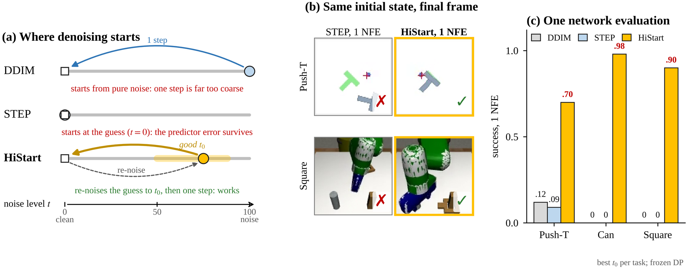
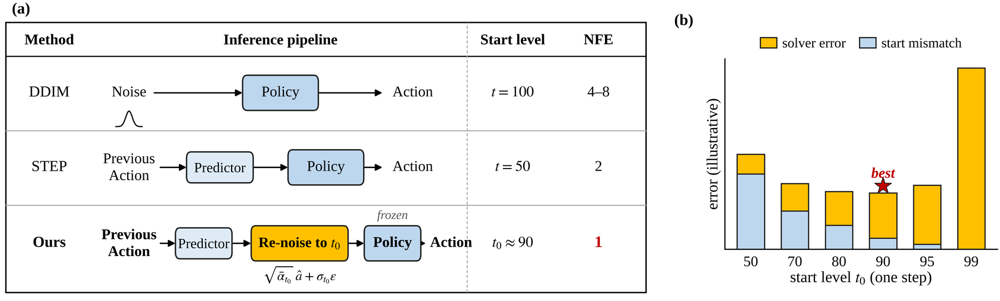
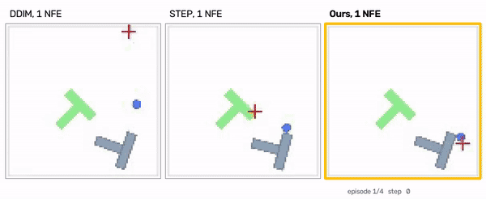
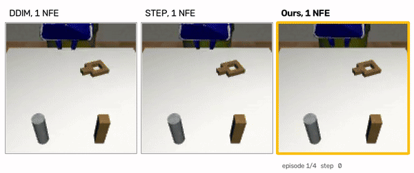
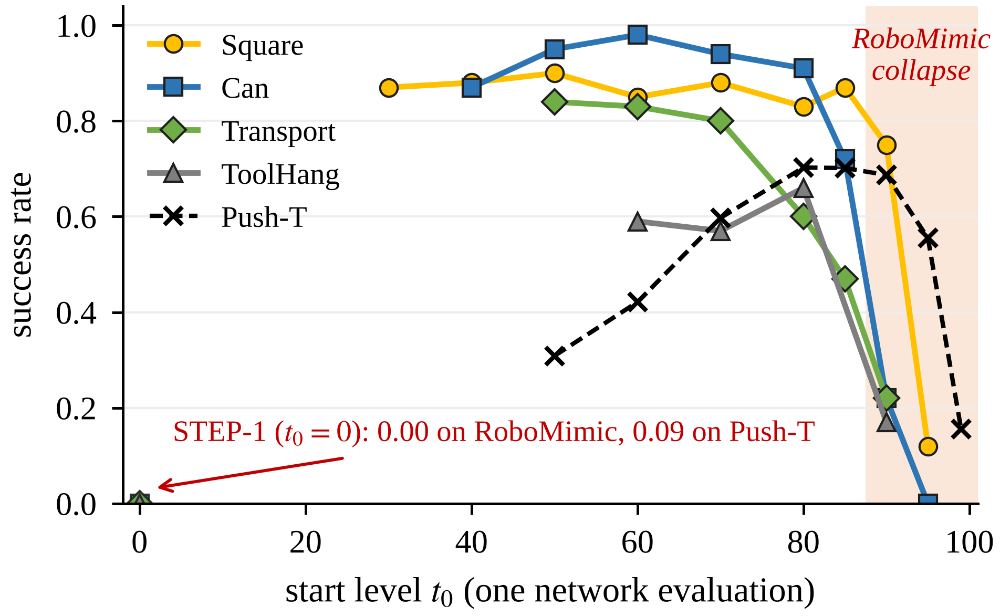
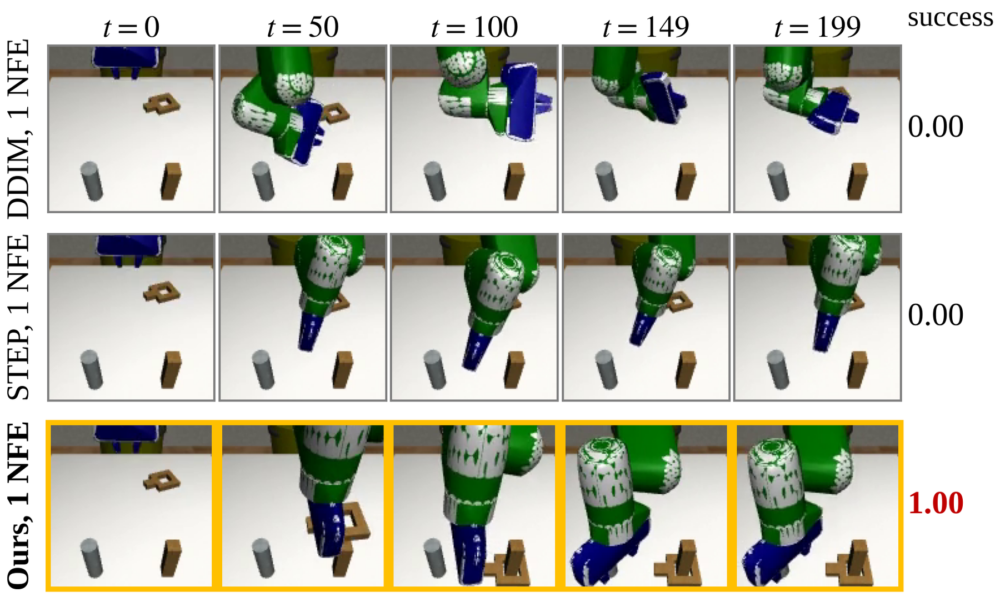
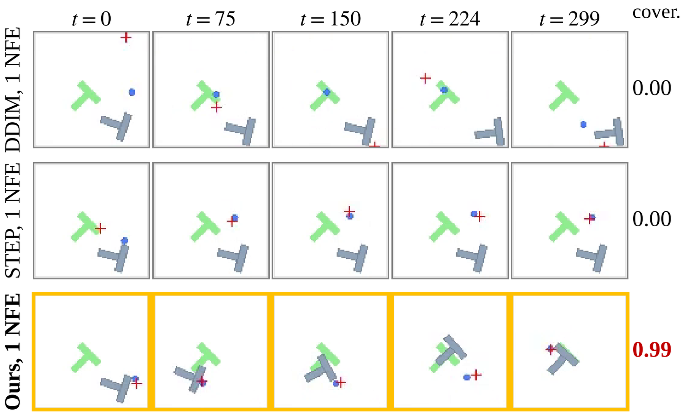
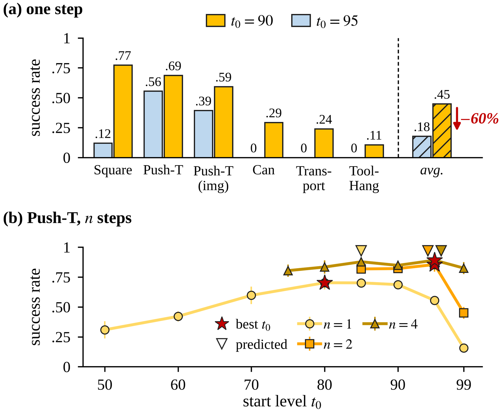

# Start High, Step Once: One-Step Warm-Started Diffusion Policies

[[Paper (under review, RA-L)]](#) [[Videos]](#-demos-one-network-evaluation-per-action-chunk) [[Results]](#-results) [[Raw data]](results/v2) [[STEP (base method)]](https://arxiv.org/abs/2602.08245) [[Diffusion Policy]](https://github.com/real-stanford/diffusion_policy)

*Anonymous authors (under double-blind review)*

**HiStart** re-noises a cheap action guess to a *high* noise level, and the **unchanged** Diffusion Policy then
finishes in **one** network evaluation. It needs no distillation and no retraining of the policy.





---

## 🎬 Demos: one network evaluation per action chunk

Each clip shows the three methods side by side, all starting from the **same initial state** and using the **same
frozen Diffusion Policy**. Only the start of the denoising process differs.

### Push-T

<p align="center">
  
  <br>Mean coverage over the first 16 test episodes: DDIM <b>0.14</b> · STEP <b>0.10</b> · HiStart <b>0.78</b>
  <br>⬇ <a href="https://github.com/wangyk10086/STEP-ustep/raw/ustep/video/pusht_one_step.mp4">download the full Push-T video (mp4, 66 s, 4 episodes)</a>
</p>

### RoboMimic Square (official DP checkpoint)

<p align="center">
  
  <br>Successes over 12 test episodes: DDIM <b>0/12</b> · STEP <b>0/12</b> · HiStart <b>9/12</b>
  <br>⬇ <a href="https://github.com/wangyk10086/STEP-ustep/raw/ustep/video/square_one_step.mp4">download the full Square video (mp4, 47 s, 4 episodes)</a>
</p>

---

## 💡 TL;DR

- **The problem.** Warm starts such as [STEP](STEP_README.md) refine a predicted action chunk from a *low* noise
  level. At 1 network evaluation (NFE) the predictor's error passes through untouched, and success drops to the level of
  DDIM from pure noise, which is about 0.
- **The fix.** Forward-noise the prediction with the **exact forward marginal** to a well-chosen start level `t0`,
  then run `n = 1–2` DDIM steps of the **frozen** policy. There is no distillation, no teacher or student, and no
  fine-tuning.
- **Why it works.** A two-term error bound, start mismatch plus solver error, has an interior minimum `t0*`. Both terms
  can be measured **offline**, without rollouts.
- **Results.** With 1 NFE, HiStart reaches 0.66–0.98 on RoboMimic Can, Square, Transport and ToolHang (official DP
  checkpoints), while STEP-1 and DDIM-1 reach 0. It also runs 57× faster than 100-step DDPM.

---

## 🧠 How it works

The second figure above summarizes the method.

**(a)** DDIM denoises from pure noise. STEP refines the predictor's guess from a low level (`t = 0` for one step,
`t = 50` for two). HiStart keeps STEP's predictor and the frozen DP, and only **re-noises** the guess:

```
x_{t0} = sqrt(ᾱ_{t0}) · â  +  sqrt(1 − ᾱ_{t0}) · ε          # exact forward marginal at t0
a      = DDIM_n( DP_frozen, x_{t0}, t0 → 0 )                 # n = 1 or 2 network evaluations
```

**(b)** The error of a warm start is bounded by two terms:

```
B(t0, n) = ½ · sqrt(SNR(t0) · m)  +  C(t0, n)
           └── start mismatch ──┘    └ solver ┘
```

Here `m` is the predictor's mean-squared error.
- Raising `t0` shrinks the mismatch term but lengthens the path the solver must cover in `n` steps.
- For DDIM, `C = ½ κ L` with `κ = nΣh²/Λ² ∈ [1, n]`.
- The sum is smallest at an interior `t0*`, and that minimum moves up as the step budget grows.

---

## 📊 Results

### Main table: closed-loop success at 1, 2 and 4 NFE

The table uses one global start level per budget (`t0 = 90 / 85 / 95`) and the public DP checkpoints. The best
entry in each budget is in **bold**. † marks numbers reported by the STEP paper with its own checkpoints.

| Task | DDIM-1 | STEP-1 | **Ours-1** | DDIM-2 | STEP-2 | **Ours-2** | DDIM-4 | STEP-4 | **Ours-4** |
|---|---|---|---|---|---|---|---|---|---|
| Push-T | .12 | .09 | **.69** | .19 | .49† | **.82** | .71 | **.91†** | .89 |
| Push-T (img) | .10 | .10 | **.59** | .63 | **.75** | **.75** | .77 | .80 | **.81** |
| Can | .00 | .00 | **.28** | .41 | .96 | **.98** | .98 | .98 | **.99** |
| Can (img) | .00 | .00 | **.81** | .39 | **.99** | **.99** | – | – | – |
| Square | .00 | .00 | **.74** | .72 | .92 | **.94** | .90 | **.94** | .92 |
| Square (img) | .00 | .00 | **.83** | .62 | .93 | **.94** | – | – | – |
| Transport | .00 | .00 | **.26** | .13 | **.86** | .85 | .80 | .82 | **.85** |
| ToolHang | .00 | .00 | **.14** | .05 | **.62** | .51 | **.57** | .55 | .47 |

### One step on RoboMimic with the official DP checkpoints

<p align="center">
  
</p>

| `t0` (1 NFE) | 40 | 50 | 60 | 70 | 80 | 85 | 90 | 95 |
|---|---|---|---|---|---|---|---|---|
| Square | .88 | **.90** | .85 | .88 | .83 | .87 | .75 | .12 |
| Can | .87 | .95 | **.98** | .94 | .91 | .72 | .22 | .00 |
| Transport | – | **.84** | .83 | .80 | .60 | .47 | .22 | – |
| ToolHang | – | – | .59 | .57 | **.66** | – | .17 | – |

These runs use low-dim observations, PH data and absolute actions. The predictors were retrained with the STEP
recipe, and each closed-loop number is 2 seeds × 50 episodes.

Success is **flat over a wide range of start levels** and **collapses near the top** (`t0 ≥ 90`). Starting at
`t0 = 0`, which is STEP-1, fails on every task. With a per-task start level, a single network evaluation is enough
on all four RoboMimic tasks.

<p align="center">
  
  <br><em>Square, one NFE, same initial state. DDIM-1 and STEP-1 never grasp the nut, while HiStart picks it up and
  places it on the peg.</em>
</p>

<p align="center">
  
  <br><em>Push-T, one NFE, same initial state (seed 100014). DDIM-1 and STEP-1 leave the T-block almost where it
  started, while HiStart pushes it onto the target.</em>
</p>

### Choosing the start level

<p align="center">
  
  <br><em>(a) A small shift of the one-step start level, from 90 to 95, lowers success on every task.
  (b) On Push-T the best level rises with the step budget. Stars mark the best level and triangles the offline
  prediction.</em>
</p>

**Offline prediction of `t0*`** needs no rollouts and takes about one minute on one GPU.

| | Push-T | RoboMimic (4 tasks) |
|---|---|---|
| **n ≥ 2**: bound with conservative `m` | 95. This is the closed-loop optimum and loses nothing. | 95 on every task, within 0.04 of the best level tested |
| **n = 1**: bound with conservative `m` | 85. The closed-loop optimum is 80–85. | 90, which overshoots into the collapse and loses 0.15–0.76 |
| **n = 1**: minimizer of the measured warm-start error | – | 60–70, losing 0.01–0.09 on Square, Transport and ToolHang |

For one step, the bound reliably finds *where success collapses*, but not the exact optimum. Because success is flat
below the collapse, a level somewhat below it is a robust default. We recommend checking two or three levels in
closed loop.

### Latency

Measured on Push-T low-dim, batch 1, RTX PRO 5000, in ms per action chunk:

| DDPM-100 | DDIM-1 | DDIM-2 | DDIM-4 | STEP-1 | STEP-2 | STEP-4 | **Ours-1** |
|---|---|---|---|---|---|---|---|
| 710 | 7.6 | 14.5 | 28.5 | 12.3 | 19.4 | 33.2 | **12.3–13.1** |

---

## 🛠️ Installation and quick start

The environment is the same as STEP and Diffusion Policy (`conda_environment.yaml`). On a fresh Linux GPU machine,
`experiments/v2/setup_v2.sh` builds a venv with torch 2.7 / cu128. With torch ≥ 2.6, set
`TORCH_FORCE_NO_WEIGHTS_ONLY_LOAD=1` so that the dill-pickled DP checkpoints load.

**Checkpoints**
- The Push-T low-dim action predictors are in `checkpoints/pusht_lowdim/`. All Push-T numbers use
  `step_varhead.ckpt`.
- The official DP checkpoints come from the Diffusion Policy release at `diffusion-policy.cs.columbia.edu`.
  `experiments/v2/dl_robomimic.sh` downloads the RoboMimic data and checkpoints in parallel.
  `experiments/v2/dl_wayback.sh` is a fallback that fetches the Push-T checkpoint from the Internet Archive.

**1. Pick the start level offline**

```bash
python experiments/v2/solver_error.py \
  --action_predictor_ckpt checkpoints/pusht_lowdim/step_varhead.ckpt \
  --diffusion_policy_ckpt /path/to/pusht_dp.ckpt \
  --history none --t0 50 60 70 80 85 90 95 --n 1 2 3 4 \
  --out results/solver_pusht.json
```

**2. Run HiStart in closed loop.** This command runs DDIM-1, STEP-1 and HiStart-1 from the same initial states and
records videos.

```bash
python experiments/v2/sim_rollouts.py \
  --action_predictor_ckpt checkpoints/pusht_lowdim/step_varhead.ckpt \
  --diffusion_policy_ckpt /path/to/pusht_dp.ckpt \
  --modality lowdim --t0 90 --n 1 --n_test 16 --out results/sim_pusht
```

**3. Sweep the start level in closed loop**

```bash
python experiments/fixed_start_sweep.py --action_predictor_ckpt PRED.ckpt --diffusion_policy_ckpt DP.ckpt \
  --grid 50:1 60:1 70:1 80:1 90:1 85:2 95:2 --n_test 50 --eval_seeds 100000 100100 --out_root results/sweep
```

**4. Latency**

```bash
python bench_latency.py --action_predictor_ckpt ... --diffusion_policy_ckpt ... --steps 1 2 4 --n_calls 300
```

**Full pipelines.**
- Push-T: `experiments/v2/run_pusht.sh`.
- RoboMimic: `experiments/v2/dl_robomimic.sh`, then `experiments/v2/run_robomimic.sh`.
- `experiments/v2/pod_scripts/` holds the exact scripts that produced the RoboMimic numbers above.

---

## 🗺️ Codebase (additions on top of STEP)

```text
diffusion_policy/policy/adaptive_warmstart.py   # exact forward-marginal warm start + DDIM schedule from t0
experiments/
├── fixed_start_sweep.py # closed-loop sweep over (t0, n)
└── v2/
    ├── solver_error.py  # offline solver term and predictor error -> predicted t0*
    ├── sim_rollouts.py  # DDIM / STEP / HiStart rollouts with video from identical initial states
    ├── setup_v2.sh, dl_robomimic.sh, run_robomimic.sh, run_pusht.sh
    └── pod_scripts/     # scripts exactly as run for the RoboMimic results
paper_plotting/          # paper figures and tables (STEP-paper style), video and GIF makers
results/v2/              # Push-T follow-up: offline errors, sweeps, latency
results/v2/robomimic/    # RoboMimic: offline errors, fixed-start sweeps, Square rollout videos, logs
checkpoints/pusht_lowdim # Push-T action predictors
media/                   # README figures and demo GIFs
video/                   # supplementary videos (one per task)
STEP_README.md           # original STEP documentation (predictor training, real robot, ...)
```

## 🎨 Reproducing the figures and videos

```bash
cd paper_plotting
python clean_data.py && python figures.py && python tables.py
python teaser_figure.py --pusht_root <sim_pusht> --square_root <sim_square> --out teaser
python rm_sweep_figure.py --rm <robomimic_v2_summary.json> --pusht <raw_results.csv> --out fig_rm_sweep
python sim_figure.py --manifest <sim_out>/manifest.json --video_root <sim_out> --seed 100014 --out fig_sim
python make_video.py --manifest <sim_out>/manifest.json --video_root <sim_out> \
  --seeds 100014 100003 100002 100006 --out pusht_one_step.mp4
```

## 🏷️ License

MIT, as in the upstream code (see `LICENSE`).

## 🙏 Acknowledgement

This code builds on [Diffusion Policy](https://github.com/real-stanford/diffusion_policy) and
[STEP](https://arxiv.org/abs/2602.08245). The RoboMimic tasks come from
[robomimic](https://github.com/ARISE-Initiative/robomimic). 